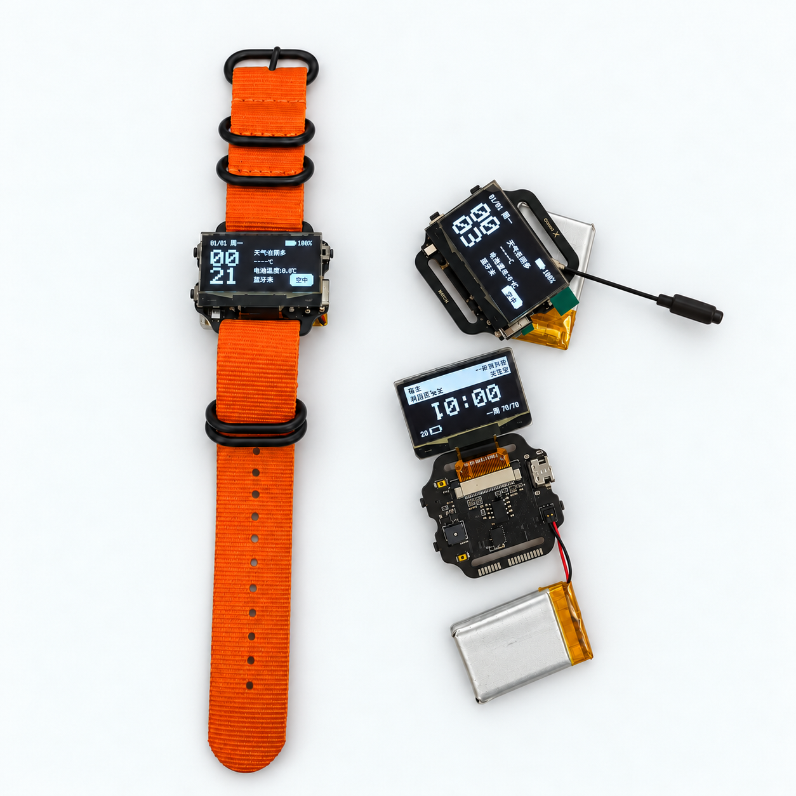
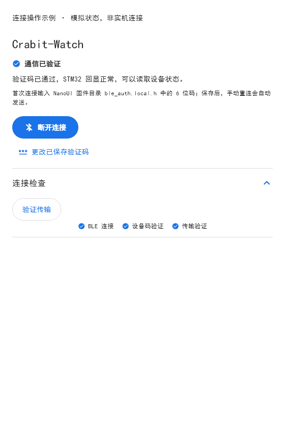

# Crabit

一块可以自己修改软硬件的双芯片手表：看时间、读取传感器、运行小游戏，也可以写自己的界面和工具。

  

[下载固件与 App](https://github.com/cusrul/Crabit/releases) · [图文文档](https://zzoo.asia/docs/crabit/) · [快速上手](showcase/docs/start.md)

安装、适用硬件与公开初始验证码见[预览版下载说明](docs/downloads.md)。

## 可以做什么

- **日常使用**：多款表盘、时间与天气、蓝牙状态、运动唤醒与 STOP2 休眠。
- **传感器与交互**：六轴惯性、气压/温度、光学滑动输入、按键、蜂鸣器和 RGB 彩灯。
- **Wi-Fi 工具**：无线扫描、抓包监听与网络审计；仅用于自有或明确授权的网络。
- **BLE 测试**：弹窗与广播兼容性测试；仅用于自有或明确授权的设备。
- **USB 键盘脚本**：可通过 Flutter 客户端编辑并上传 BadUSB 键盘脚本；仅在自有设备或明确授权的环境中使用。
- **自己开发**：原理图、PCB、双端固件、NanoUI 与 Flutter 客户端都在仓库里。先在 Windows 预览界面，再接入真实手表。

STM32L432 负责设备控制、低功耗、传感器和 USB；BW16 / RTL8720DN 负责无线。
OLED 使用 NanoUI，客户端支持 Android 与 Windows，并带有可操作的 3D 手表预览。

看看 Flutter 客户端

界面示例用于说明操作位置，不代表本次连接了真实设备。

## 从哪里开始

- 从GitHub取得源码并验证构建：[复现说明](docs/reproduction.md)

- 已拿到手表：[快速使用](showcase/docs/start.md) · [连接客户端](showcase/docs/connect.md) · [App 操作](showcase/docs/app-guide.md)
- 开始开发：[环境搭建](showcase/docs/setup.md) · [第一个 App](showcase/docs/first-app.md) · [系统导读](showcase/docs/system-walkthrough.md)
- 编译设备：[构建与烧录](docs/guide/build-and-flash.md) · [硬件工程](hardware/altium/crabit-v2/README.md)
- 更多说明：[文档目录](docs/README.md) · [贡献指南](CONTRIBUTING.md)

## 源码目录

| 目录 | 内容 |
| --- | --- |
| firmware/stm32 | 设备控制、传感器、USB、供电与本机 UI |
| firmware/rtl8720dn | BW16 Arduino 固件、无线与独立 UI 模式 |
| firmware/shared | 双端通信与设备设置契约 |
| libraries/NanoUI | UI 核心、平台适配、示例、字体与图片工具 |
| apps/mobile | Flutter 客户端及本地模型预览 |
| hardware/altium | 可编辑 Altium 工程及完整引用库 |
| showcase | 图文使用和开发教程 |
| tools | 构建、资源与测试辅助工具 |

当前为开发源码快照，不是成对固件的稳定发行包。桌面预览不能替代实机验收；
烧录前确认实际板卡、镜像边界和所用固件组合，不直接更改供电、启动与 Flash 布局。

## 授权

本项目有权授权的原创内容采用 **GPL-3.0-only**，允许遵守条款的商业使用、修改和分发。
适用范围及第三方组合限制见[授权说明](LICENSING.md)。
第三方代码、字体、模型和硬件库保留原授权，见[第三方来源](THIRD_PARTY_NOTICES.md)。
