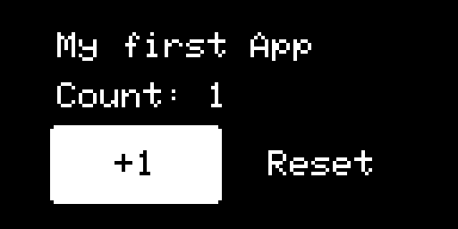
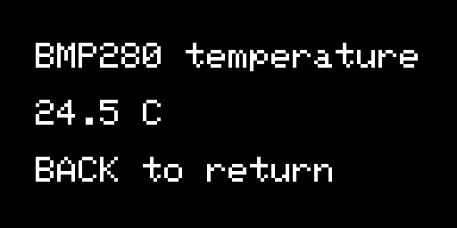

先完成[环境准备](setup.md)与[桌面第一个 App](first-app.md)。本章不重写 UI 框架，不改供电、USB、低功耗或烧录桥。所有命令未特别注明时，都在源码根目录运行。

本章对应带有 `showcase/examples/device-apps/` 的源码版本。与已下载固件不同，下面的教程改动需要你在自己的工作副本编译；它们没有默认加入出货菜单。

## 1. 先明确做成什么

新增一个 Counter 页面：确认键给计数加一，方向键选择 Reset，再确认清零。返回退出 App；重新进入从零开始。第一版故意只用英文，不需要生成中文字体，不连接手机，也不写 Flash。

文件位置与职责：

| 文件 | 做什么 |
| --- | --- |
| `showcase/examples/device-apps/app_counter.h` | 可完整复制的 App 定义 |
| `firmware/stm32/Core/NanoUI/app_real/launcher.h` | STM32 真正的产品菜单入口 |
| `firmware/stm32/Core/NanoUI/app_real/app_counter.h` | 本章由你创建的产品 App 文件 |
| `firmware/stm32/Core/Src/nanoui_port.cpp` | 已有平台入口，本章不要修改 |

`Application` 是框架的应用对象，不是 FreeRTOS 线程。`AppManager::launch()` 管理创建、界面和退出，你不需要再写任务或 `while(1)`。

## 2. 先在 Windows 检查这个完整 App

已有前文的 Visual Studio C++ 环境时，在 Developer PowerShell 执行：

```powershell
cmake -S showcase/examples/device-apps -B build/device-apps -DBUILD_TESTING=ON
cmake --build build/device-apps --config Release
ctest --test-dir build/device-apps -C Release --output-on-failure
$preview = Get-ChildItem build/device-apps -Recurse -Filter DeviceAppPreview.exe |
  Select-Object -First 1 -ExpandProperty FullName
if (-not $preview) { throw '没有找到预览程序，先检查构建错误' }
& $preview
```

窗口里 Enter 确认，方向键切换 +1 / Reset。按 T 打开模拟温度页，Esc 返回计数器；在根页面按 Esc 不会关闭窗口，用窗口右上角关闭。



*真实 NanoUI 控件输出，测试已模拟一次确认，计数为 1；不是实机照片。*

测试默认使用 NanoUI 池化容器配置，检查加一、清零、返回和重复进出后的 UI 分配释放。桌面内存测量不等于 STM32 的实际堆栈余量，也不能代替烧录后的检查。

## 3. 认识完整源码

打开 `showcase/examples/device-apps/app_counter.h`。核心组合如下；完整类以该文件为准，复制时复制整个文件，不只复制 `buildUI()`：

```cpp
Widget* buildUI() override {
    return new Container(new Column({
        new Text("My first App", 8),
        new SizedBox(0, 6),
        new Text(value, 8),
        new SizedBox(0, 6),
        new Row({
            new Button(new Container(new Text("+1", 8), 44, 18),
                       [this]() { setCount(count < 999 ? count + 1 : 999); }),
            new SizedBox(8, 0),
            new Button(new Container(new Text("Reset", 8), 44, 18),
                       [this]() { setCount(0); })
        })
    }), 128, 64);
}
```

`count` 和 `char value[20]` 是 App 成员。回调修改计数，再格式化文字并请求重新布局。不要写 `new Text(String(...).c_str())`，临时对象销毁后，绘制对象可能还在使用它的地址。

框架拥有通过 `new` 交给它的 Widget 和 RenderObject；App 对象在退出时销毁。不要在按钮回调里自己 `delete this`，也不要手工删除已交给框架的控件。

## 4. 把它注册到真正的 STM32 菜单

先关闭预览窗口，保留自己原有修改或建立 Git 提交。确认目标文件不存在，避免覆盖同名 App：

```powershell
$target = 'firmware/stm32/Core/NanoUI/app_real/app_counter.h'
if (Test-Path $target) { throw '目标已存在，请先核对，不直接覆盖' }
Copy-Item showcase/examples/device-apps/app_counter.h $target
```

编辑 `firmware/stm32/Core/NanoUI/app_real/launcher.h`：

1. 在现有产品 App 的 `#else` 分支里，紧接 `#include "app_ws2812_control.h"` 添加：

```cpp
#include "app_counter.h"
```

2. 找到 `class FolderToolsApp` 的 `buildUI()`，在 `buildIconListMenu({` 的列表中、彩灯控制前加一项：

```cpp
{icon_term, "Counter", []() { AppManager::launch(new CounterApp()); }},
```

注意它后面的逗号。这让入口出现在 **开发工具 → Counter**，不是系统设置里面。`getAppName()` 本身不会自动注册菜单。头文件由菜单包含，不需要为这个纯头文件 App 修改 CMake 源文件列表。

不要把新代码放进 `app_desktop`、`app_new` 或历史备份目录，它们不是当前 STM32 产品入口。

## 5. 编译，核对后再运行到手表

先按[构建与恢复](update.md)准备已有的 Arm 工具链、CMake 和 Ninja，然后在根目录：

```powershell
powershell -NoProfile -ExecutionPolicy Bypass -File tools/build-stm32.ps1
```

应成功链接 `firmware/stm32/build/MinSizeRel/crabit_st.elf` 并显示 RAM / FLASH 使用量。出错先看第一条，不放大链接区或内存池来掩盖错误。STM32L432CBU6 是 256 KiB Flash，不能把这个 ELF 用在容量不同的板卡。

仅由你按对应硬件的已知烧录方式更新 STM32；不需要为这个 App 重刷 BW16。保存上一套可用 ELF。本教程不会替你自动复位或烧录，也不替代接口接线说明。

手表预期：开发工具能看到 Counter；确认进入，+1 与 Reset 正常；返回回到开发工具；重新进入为 0。若菜单没有 Counter，先确认编译的是这个工作副本、烧入的是本次 ELF，而不是尝试改启动流程。

## 6. 再做一个真正读取传感器的 App

`showcase/examples/device-apps/app_temperature.h` 是第二个完整示例。它读取 BMP280 芯片温度，不是人体体温，也不保证等于环境温度。

按与计数器相同方式复制到 `app_real/app_temperature.h`，在同一产品 `#else` 分支包含：

```cpp
#include "app_temperature.h"
```

在同一个开发工具列表增加：

```cpp
{icon_term, "Temperature", []() { AppManager::launch(new TemperatureApp()); }},
```

它的 `onTick()` 只做这些事：复制 `STM32_GetUiSensorSnapshot()`；检查读取成功、`pressure.is_valid`、该传感器的 `timestamp` 不超过 5 秒、温度有限且在示例允许范围；有效时用 `FormatFixed1()` 更新成员缓存，否则清为 `N/A`。只在文字变化时请求重新布局。



*同一个 TemperatureApp 的主机渲染，24.5 C 是测试输入，不是真实手表读数。测试还覆盖无快照、无效、过期和 NaN，不让旧读数假装正常。*

不要在 `buildUI()` 里读 I2C、创建传感器驱动或重新给传感器上电。SDK 采集由平台管理；UI 消费快照。完整链路解释见[系统导读](system-walkthrough.md)。

## 7. 按键与保存什么时候才需要扩展

本例的按钮由框架处理 `EVT_OK`，方向键移动焦点，返回由 AppManager 退出。不要一边用框架输入，一边额外轮询同一 GPIO，避免一个按键触发两次。

本例是 RAM 计数，重进或重启归零是设计行为。如果只想调手表现有亮度、息屏和反馈，使用已有设置页并点“应用”。学习保存路径时，依次阅读 `app_real/app_settings.h` 的 `apply()`、`Core/Inc/sys_config.h` 的 `ConfigManager::save()` 和客户端设置契约。

**不要为了保存计数直接扩展 SystemConfig、挑一个空 Flash 地址或每次 onTick 写 Flash。** 新应用自己的持久化字段需要版本、容量、校验和迁移设计，不属于本章的安全入门练习；目前本例没有存储接口，也不声称已实现。

## 8. 出错如何恢复

只撤回你新增的两个 include、两条菜单项和自己的示例文件，再构建；不要重置整个仓库或覆盖别人修改。硬件运行异常时使用保留的已知可用 ELF 回退，不同时替换两颗芯片。

新增中文看[资源教程](resources.md)。池化配置的单个容器及焦点表存在容量上限，页面也有总内存预算；不能无限增加控件。优先保持示例的小页面，不复制完整设置页作为 App 模板。

完成标志：你能说出入口在哪、状态属于谁、确认键怎样改值、返回怎样释放页面，并独立完成一次修改—构建—运行—恢复。下一章把同一个 Counter 放到 [BW16](bw16-first-app.md)，不要把 STM32 传感器头文件也复制过去。

## 本章示例的验证范围

2026-11-05：独立 Windows 示例用 MSVC 19.43 和 GCC 14.2 各完成构建及 CTest；使用池化容器配置，测得本测试跟踪的 UI 峰值为 2112 字节，退出后为零，包含 50 次温度页进出。该数值不包含所有系统开销，不是手表可用 RAM 的测量。

在独立工作副本按第 4、6 步注册两个 App，STM32 MinSizeRel 编译通过，链接 FLASH 202848 字节、主 RAM 区 59440 字节。这里只证明设备目标编译通过，没有为教程重新烧录或实测；正式产品源码和原交付固件未加入这些示例。
